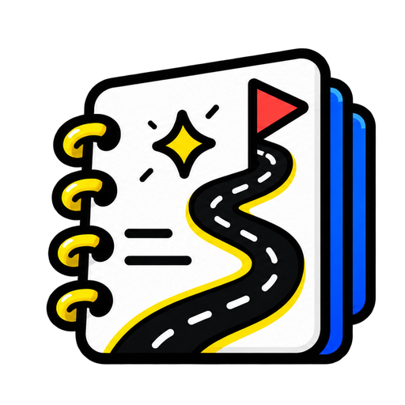

<div align="center">
  
  <h1>zehniq.</h1>
  <p><strong>Learn it. Understand it. Own it.</strong></p>
  <p>Your sources. Better questions. A path to understanding.</p>
</div>

---

Zehniq turns scattered learning material into a workspace for asking questions, making connections, and putting knowledge into practice.

### Bring the material. Make it yours.

- **Collect** PDFs, websites, YouTube lectures, text, and Markdown in notebooks.
- **Ask** questions with streaming answers, source citations, and optional web search.
- **Create** summaries, flashcards, quizzes, reports, takeaways, and interactive mind maps.
- **Follow a path** with 4-, 8-, or 12-week roadmaps, study resources, checklists, and saved progress. Start inside a notebook or build independently from sources and topics.
- **Make it personal** with learning preferences and memories you can view, edit, and delete.

Neo-brutalist design. Light and dark themes. Mobile, tablet, and desktop layouts.

### Under the hood

**The interface**


**The foundation**


**The intelligence**


**The supporting cast**


Source-grounded answers. Persistent memory. Background processing that keeps the learning flowing.

### Run locally

Requires **Node.js 24**, **pnpm 11**, PostgreSQL, and credentials for the integrations you use.

**1. Install and configure.**

```sh
pnpm -C server install
pnpm -C client install
cp server/.env.example server/.env
cp client/.env.example client/.env.local
```

Set your database, Google OAuth, and provider credentials in `server/.env`. See the [environment reference](.env.example) for provider variable names. For local development, use `CLIENT_URL=http://localhost:3000` and `INNGEST_DEV=1`.

Google OAuth callback: `http://localhost:8081/api/auth/callback/google`.

**2. Set up the database.**

```sh
pnpm -C server contract:emit
pnpm -C server exec prisma db migrate
pnpm -C server exec prisma db verify
```

**3. Start each process in a separate terminal.**

```sh
# API
pnpm -C server dev

# Client
pnpm -C client dev

# Background jobs
pnpm dlx inngest-cli@latest dev -u http://localhost:8081/api/inngest
```

Open [localhost:3000](http://localhost:3000). Without signing in, you can explore a local preview. Live AI features require authentication and configured providers. Keep provider secrets on the server.

---

[Client guide](client/README.md) · [Server guide](server/README.md) · [Roadmap architecture](server/docs/roadmaps.md)
